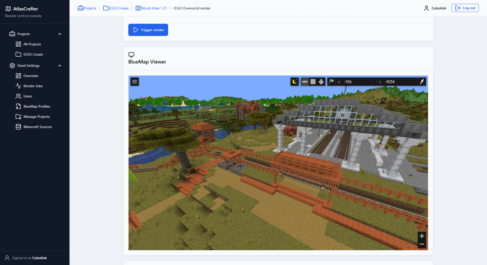
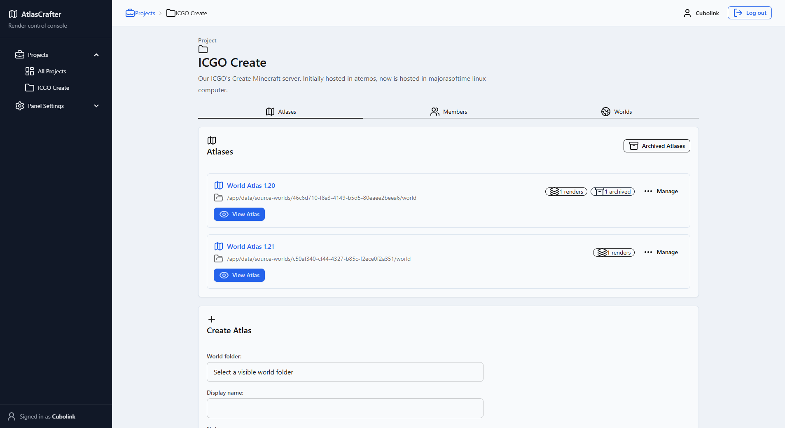
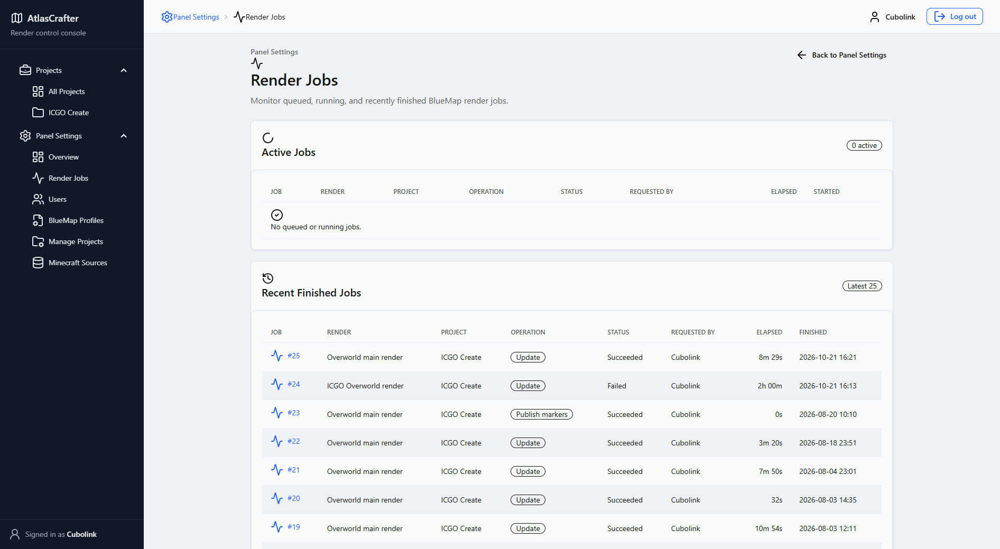

# AtlasCrafter

**A self-hosted web panel for configuring, rendering, and sharing Minecraft maps with [BlueMap](https://github.com/BlueMap-Minecraft/BlueMap).**

Give your community a place to explore its worlds, and your administrators a UI to manage them. AtlasCrafter adds project access, configuration forms, a render queue, and marker editing around BlueMap's 3D viewer.

[Getting started](docs/GETTING_STARTED.md) · [User guide](docs/USER_GUIDE.md)



*Explore a rendered world inside AtlasCrafter. BlueMap provides the 3D renderer and viewer; AtlasCrafter adds configuration, render management, and access controls.*

## Current features

- **Organize your worlds.** Group worlds into Projects and create multiple map configurations for each world: different dimensions, day/night views, cave views, or selected regions.
- **Configure maps through forms.** Set lighting, colors, camera defaults, render masks, and Minecraft resources, then preview the generated BlueMap configuration.
- **Render from the browser.** Queue incremental updates or full rebuilds, inspect logs and elapsed times, and monitor jobs across the panel.
- **Manage map markers.** Create points of interest, styled labels, lines, areas, and volumes alongside the published map. Prepare drafts and publish marker changes separately from terrain renders.
- **Control who can see and manage maps.** Assign administrators and read-only users per Project. Access checks cover both viewer pages and map assets.
- **Use modded world resources.** Discover server folders and register reusable mod/resource sources for BlueMap.

AtlasCrafter runs independently of your Minecraft server manager. It uses the **standalone BlueMap CLI** to read world files and generate maps; BlueMap provides the renderer and interactive viewer. Source worlds and resource folders are mounted read-only in the included Docker setup.

## Screenshots

| Organize worlds and Atlases | Monitor render jobs |
| :---: | :---: |
| [](docs/images/project-view.png) | [](docs/images/jobs-view.png) |
| Keep multiple worlds or seasons in one Project. | Inspect updates and marker publications from one overview. |

*Administrator views from an ICGO Create deployment. Click a thumbnail for the full image. A fresh installation starts without Projects or generated maps.*

For source discovery and mod/resource detection, see the [Minecraft Sources example](docs/USER_GUIDE.md#minecraft-source-discovery).

## How worlds are organized

| Term | What it means | Example |
| :--- | :--- | :--- |
| **Project** | A collection of managed worlds and its own member access. | Survival Server |
| **Atlas** | One physical Minecraft world folder within a Project. | Survival World |
| **Render** | One BlueMap map configuration for that Atlas. | Overworld Day, Overworld Night, or The Nether |

A superadministrator chooses which world folders a Project may use. A Project Administrator then creates Atlases from those folders and adds Renders. Making a world folder available does not create an Atlas automatically.

## Try it locally with Docker

You need Docker with Compose, a Minecraft **Java Edition** world, and a compatible [BlueMap CLI jar](https://github.com/BlueMap-Minecraft/BlueMap/releases). BlueMap is downloaded separately.

1. Clone this repository and enter its directory:

   ```sh
   git clone https://github.com/Cubolink/AtlasCrafter.git
   cd AtlasCrafter
   ```

2. Place the CLI jar at `data/bin/bluemap-cli.jar` and your world folder under `data/source-worlds/`. Each world folder must contain its `level.dat`. Optional mod/resource sources go under `data/resource-sources/`.

3. Build and start the panel, worker, and PostgreSQL database:

   ```sh
   docker compose up --build -d
   docker compose exec web python manage.py createsuperuser
   ```

   Wait for the web service to finish its initial migrations before creating the user. Open **[localhost:8000](http://localhost:8000)** and sign in.

4. Follow [your first map](docs/USER_GUIDE.md#your-first-map): discover sources, create a Project, add an Atlas and Render, then queue a render.

BlueMap may stop its first job to generate `core.conf` and request permission to download Minecraft resources. Read that file and follow [the first-run instructions](docs/GETTING_STARTED.md#bluemaps-first-run), then trigger the render again.

This is a **local development setup**, using Django's development server and default database credentials. See [installation and deployment notes](docs/GETTING_STARTED.md) before making it accessible to other machines. Native Linux and Windows instructions are included there too.

## Project status

The core management, render, marker, and protected-viewer workflows are implemented. The project is actively developed; **scheduled job execution and editable raw-config round-tripping are not implemented**. The included Compose stack does not include a production application server or Nginx.

Current implementation: Django and Django templates, Tailwind CSS/DaisyUI, a database-backed render worker, SQLite for native development, and PostgreSQL in Compose. See [architecture](docs/ARCHITECTURE.md) for how the components fit together.

## Documentation

| I want to… | Read |
| :--- | :--- |
| Install the panel, configure paths, or troubleshoot a first render | [Getting started](docs/GETTING_STARTED.md) |
| Manage worlds, access, Renders, and markers | [User guide](docs/USER_GUIDE.md) |
| Understand the backend and protected asset delivery | [Architecture](docs/ARCHITECTURE.md) |
| Find the current HTML, form, and JSON routes | [Routes and endpoints](docs/ROUTES.md) |

## Feedback and contributions

[Bug reports and feature requests](https://github.com/Cubolink/AtlasCrafter/issues) are welcome, as are documentation improvements, UI feedback, and pull requests. Please include reproduction steps for bugs and describe the workflow a proposed feature would improve.

## License and credits

AtlasCrafter is licensed under the [MIT License](LICENSE). [BlueMap](https://github.com/BlueMap-Minecraft/BlueMap) is a separate project and supplies the map renderer and viewer; its CLI jar is not bundled here. Minecraft, Mojang, and any mods or resource packs retain their own licenses and terms.
