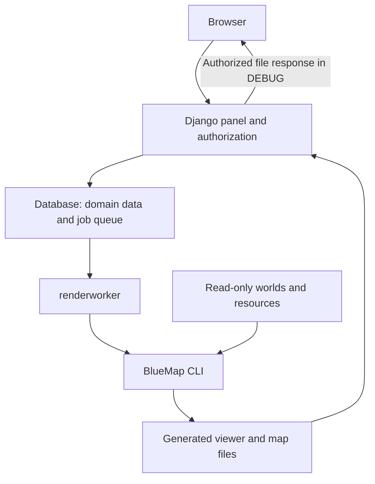

# Architecture

[Back to README](../README.md) · [Routes](ROUTES.md)

This page describes the current implementation.

## Runtime components

The panel uses Django/templates, Tailwind CSS, DaisyUI, and lucide-static icons. Small JavaScript modules handle marker editing, geometry controls, and job-status polling. There is no separate REST API or client application.

Native development defaults to SQLite. Compose uses PostgreSQL and separate `web` and `renderworker` containers from one application image. Rendering uses the standalone BlueMap CLI and needs no Celery/Redis. `django-guardian` and `django-ninja` are installed, but Project access currently uses membership rows and routes are ordinary Django views.



In production, Django uses `X-Accel-Redirect` for Nginx to transfer authorized files. Compose currently uses Django's development server and includes neither Nginx nor a production application server. See [deployment considerations](GETTING_STARTED.md#deployment-considerations).

## App ownership

| App | Responsibility |
| :--- | :--- |
| `accounts` | Users, profile settings, Panel Settings, memberships, and job overview. |
| `projects` | Discovery, Projects, Atlases, Renders, resources, marker models/forms/workspace. |
| `bluemap_configs` | Profiles, config generation, revisions, and generated-file tracking. |
| `renders` | Jobs, queue claiming, CLI execution, rebuild staging/restoration, worker. |
| `viewer` | Render wrapper, controls, config preview, job details, status polling. |
| `assets` | Authenticated, Render-scoped viewer/map asset delivery. |
| `schedules` | Schedule model only; no schedule execution. |

[config/urls.py](../config/urls.py) defines the top-level routes. [ROUTES.md](ROUTES.md) documents the HTML, form POST, asset, and JSON polling endpoints.

## Domain and access model

A `Project` is the organization/membership boundary. `ProjectVisibleWorld` exposes a pool of `WorldFolder` records. An `Atlas` explicitly selects one folder; a `Render` belongs to that Atlas. Multiple Renders may reference the same physical world through their Atlas.

`ProjectMembership` assigns Project Administrator or Project User access. Superusers have global access. Staff status enables operational Panel Settings without independently granting map management. Checks apply to views, actions, and individual assets.

| State | Meaning |
| :--- | :--- |
| `Project.is_active` | Active vs archived Project. |
| `Atlas.is_active` | Active vs archived Atlas. |
| `Render.is_enabled` | Active vs archived Render. |
| `WorldFolder.is_active` | Source available for new setup/terrain jobs vs unavailable/archived. |

Archiving a source does not hide existing map output automatically. See [archive behavior](USER_GUIDE.md#archiving-and-restoring).

## Configuration and rendering

`BlueMapProfile` supplies config/command templates. `BlueMapRenderConfig` binds a Render to a profile. Preview generates content without writes. Jobs write `<BLUEMAP_CONFIG_DIR>/maps/<bluemap_map_id>.conf`, record revisions, and track generated files.

The default render command template is:

```text
"{bluemap_cli}" -c "{config_dir}" -r
```

Jar paths run through Java. Command construction passes argument lists to subprocesses and adds map selection, resource/version options, and forced rendering where applicable. Profiles are trusted administrator configuration; normal users do not supply shell commands.

The worker claims jobs, revalidates sources, writes config, runs BlueMap with a timeout, and records output/results. Scans and render-time guards archive sources whose `level.dat` disappeared. Blocked terrain requests record explanatory failures.

Rebuilds stage only the selected Render's known map IDs below the generated maps root. Success removes the backup; failure/timeout restores it. Only queued jobs can be canceled.

## Marker publication

Marker sets/markers are structured, Render-owned database records: points of interest, styled labels, lines, areas, and volumes. Forms validate inputs; generation escapes text rather than accepting arbitrary HTML/HOCON.

Marker-only jobs use a separate command with `--markers`. Each job uses an immutable snapshot, and the Render's published baseline changes only after success. Current drafts are compared with that baseline for new/modified/pending-removal states.

The marker command omits `--maps` to account for BlueMap 5.22 behavior where marker updates with map filtering can report success without publishing. These jobs skip terrain/source checks and resource loading. See [renders/services.py](../renders/services.py).

The iframe always displays published output. Asynchronous fragments preserve its camera during draft editing; no draft overlays are injected through private BlueMap APIs.

## Protected asset delivery

Each `/renders/<id>/assets/<path>` request verifies the session and access to an active Render, Atlas, and Project. Paths are scoped to the Render's map IDs; traversal is rejected. The returned `settings.json` exposes only that map and points its data roots at the protected route.

In `DEBUG`, Django serves files directly, including gzip encoding where needed. Otherwise it returns `X-Accel-Redirect` to an Nginx `internal` location. Unauthorized scoped lookups and unrelated map IDs return 404. A public webroot alias would bypass these checks.

Workers need writable output; the serving layer needs read access. Source-world/resource mounts stay read-only. [Getting started](GETTING_STARTED.md) documents environment variables and deployment considerations.
