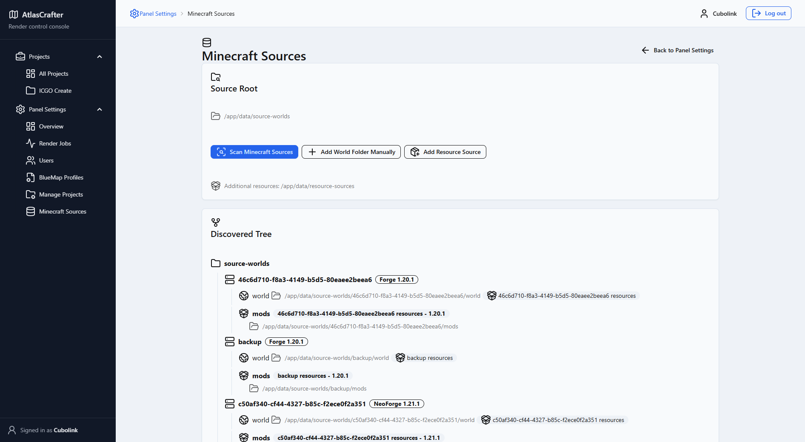
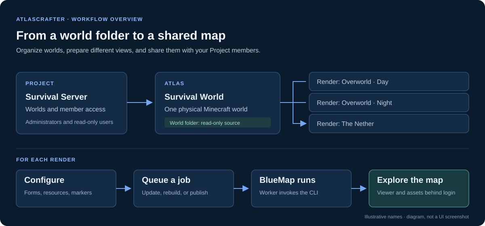

# User guide

[Back to README](../README.md) · [Installation](GETTING_STARTED.md)

## Your first map

These steps assume the panel and render worker are running and the CLI jar is configured. Sign in with the superuser created during installation.

1. **Discover sources.** Open **Panel Settings → Minecraft Sources** and scan the configured roots. Check that your world was found and is active. Each world needs `level.dat`. Server/modpack resource sources can be detected or registered here too.
2. **Create a BlueMap Profile.** Under **Panel Settings → BlueMap Profiles**, create the default CLI profile. It provides the config and command templates Renders use.
3. **Create a Project.** Under **Panel Settings → Manage Projects**, create a Project, choose its default profile, and select the world folders it may use.
4. **Create an Atlas.** Open the Project from **Projects**. In **Create Atlas**, select a visible world folder and give it a display name. The Atlas represents that one physical save.
5. **Create a Render.** Open the Atlas and use **Create Render**. Select a name, dimension, and preset. You can add more Renders for the same Atlas later.
6. **Review settings.** On the Render page, use **Manage → Edit Render** to adjust resources, lighting, camera options, and masks. **Manage → Preview Config** shows generated content without writing files.
7. **Queue a render.** Select **Trigger render**. Open the job for logs or use **Panel Settings → Render Jobs**. BlueMap's [first-run resource notice](GETTING_STARTED.md#bluemaps-first-run) may need attention before the first success.
8. **Explore the map.** The Render page embeds the protected BlueMap viewer once output exists. Members with Project access can open it too.

Source visibility, Atlas creation, and Render creation are separate steps. Scanning sources alone does not create maps in Projects.

### Minecraft source discovery

The **Minecraft Sources** screen lists discovered server roots, world folders, and associated mod resources. This deployment includes Forge and NeoForge sources; the contents of your tree depend on the folders you mount.

*Source discovery in an ICGO Create deployment. Select which discovered worlds a Project may use before creating its Atlases.*

## Projects, Atlases, and Renders

| Object | What you manage |
| :--- | :--- |
| Project | A collection of worlds, its pool of allowed world folders, and user memberships. |
| Atlas | One selected world folder within the Project. |
| Render | A BlueMap configuration for the Atlas: dimension, visual settings, resources, masks, and markers. |
| World Folder | The source save on disk, separate from generated map output. |

For example, a **Survival Server** Project can have a **Survival World** Atlas with **Overworld Day**, **Overworld Night**, and **The Nether** Renders. An archive Project can hold Atlases for previous seasons.

## User access

A superadministrator creates users through **Panel Settings → Users** and assigns Project access. A person may have different roles in different Projects.

| Role | Access |
| :--- | :--- |
| Superadministrator | Global administration, including Projects, source visibility, profiles, memberships, and all Render workflows. |
| Staff | Panel Settings, user management within staff constraints, and job monitoring. Project/map access and management still depend on membership unless also a superuser. |
| Project Administrator | Manage Atlases, Renders, config, markers, and jobs in assigned Projects. |
| Project User | Browse defined Atlases/Renders, Project members, and world folders in use; open permitted maps. Cannot change config or trigger renders. |

Both the viewer page and individual map files require access. Sharing a Render URL does not grant membership.

## Editing Render settings

Use **Manage → Edit Render** for the form-based editor. It covers dimension/preset selection, colors and lighting, start position, masks, viewer options, and Minecraft resources. Advanced fields are collapsible.

Resource modes let you inherit world/server defaults, use vanilla resources, choose a registered source, or use a custom mods path when permitted. Custom paths are restricted to superusers and must remain inside configured source roots.

Edits save to the database. A subsequent job writes the generated `.conf` and updates the map. Preview does not write files or create revisions. The **Raw Config** panel is read-only; importing arbitrary edits into the forms is not supported yet.

## Updating and rebuilding maps

| Action | Use | Effect |
| :--- | :--- | :--- |
| Trigger render | Routine world updates. | Queues a normal incremental render for this Render. |
| Manage → Rebuild Render | Regenerate existing tiles after resource/config changes. | Queues a forced rebuild; existing output is staged and restored if BlueMap fails or times out. |
| Publish Markers | Publish saved marker drafts. | Queues a marker-only BlueMap operation without rendering terrain. |

The worker executes the queue independently of the browser. Keep it running even if you close the panel. Default concurrency is one job at a time.

Permitted users can cancel queued jobs. Running-job cancellation and scheduled execution are not implemented. Job detail shows status, operation, command output, timestamps, and exit code; the job overview also shows elapsed times.

A rebuild may make the map unavailable while it runs. Restoring old output after failure does not undo saved Render settings.

## Marker workflow

Open **Manage → Manage Markers** on a Render with published output.

1. Create a **Marker Set** to group places, labels, or geometry.
2. Add a point of interest, styled label, line, area, or volume. Use the visible map as a coordinate guide and enter positions or vertices in the editor.
3. Save the drafts. The workspace identifies new, modified, and pending-removal items relative to the last successful publication.
4. Select **Publish Markers** when ready. The worker writes configuration and asks BlueMap to update markers. The publication baseline changes only after success.

The embedded viewer shows the **published** map. Draft edits are not overlaid. Selecting and saving markers preserves the mounted viewer and its camera; it reloads after publication completes.

Styled labels use predefined styles, colors, sizes, and symbols. The UI accepts no arbitrary HTML or raw HOCON for markers. Marker-only publication skips terrain rendering and source-world availability checks, but still needs the worker, CLI, and existing map output to be useful.

## Archiving and restoring

Archiving is a soft lifecycle state, separate from deleting files.

| Archived object | Effect |
| :--- | :--- |
| Project | Hidden from Projects. A superuser can manage its active state in Manage Projects. Normal child-management pages are blocked. |
| Atlas | Hidden from the Project's active Atlases. Administrators can restore it from Archived Atlases. |
| Render | Hidden from active Renders. Administrators can restore it from Archived Renders. |
| World Folder | Unavailable for new Atlases and terrain renders. Existing Atlases, Renders, and generated output stay available if their own states are active. |

Scans archive known folders whose `level.dat` disappeared and restore them when found again. Render-time guards also detect missing sources. Before restoring a source manually, make sure the save exists and is readable.

See [troubleshooting](GETTING_STARTED.md#troubleshooting) for path/worker/viewer problems.
